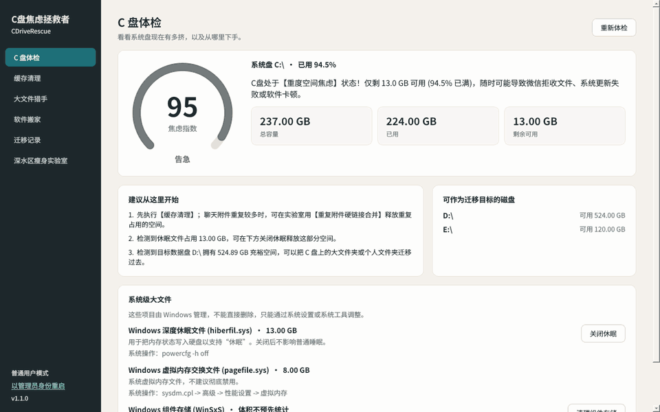

# CDriveRescue · C盘焦虑拯救者

[](https://github.com/cz-303/CDriveRescue/releases/latest)
[](https://github.com/cz-303/CDriveRescue/releases)
[](LICENSE)




<sub>界面预览（示例数据）：C 盘体检、缓存清理、大文件猎手、软件搬家、迁移记录、深水区瘦身实验室。</sub>

Windows 桌面磁盘工具：看清 C 盘为什么满、保守地清理缓存，并把大文件夹迁移到其他磁盘（先完整复制并校验；原位置留下目录联接，软件照常找得到）。

## 下载

到 [Releases](../../releases) 下载最新的 `CDriveRescue-v<版本>-win64.zip`（当前最新版为 v1.1.0），**解压整个文件夹**后运行 `CDriveRescue.exe`。不需要安装 Python。

- 仅支持 Windows 10 / 11（64 位）。
- 程序没有数字签名，首次运行可能出现“Windows 已保护你的电脑”，点“更多信息 → 仍要运行”。
- 普通启动不需要管理员权限；关闭休眠等操作需要时会提示。

## 功能

- **C 盘体检**：焦虑指数、容量、建议、可用的目标磁盘、休眠文件与虚拟内存说明。
- **缓存清理**：只匹配少数已核实的位置（系统临时文件、Chrome / Edge / Firefox、pip / npm、旧版微信缓存）。默认移入回收站，可先预演；“谨慎”项默认不勾选。
- **大文件猎手**：找出占空间的单个文件，只定位、不删除。
- **软件搬家**：完整复制并逐个 SHA-256 校验后，才把原文件夹换成目录联接；中途失败会回滚，中断后可恢复。
- **迁移记录**：查看联接状态、一键还原（目标盘副本保留，确认后自行删除）。

v1.1 新增“深水区瘦身实验室”和组件清理：

- **重复附件硬链接合并**：内容完全相同的微信/QQ 附件只保留一份数据，各路径照常可用。合并后这些路径共享同一份数据，以后修改其中一个，其他也会一起变，只适合收到后不再修改的附件。可先预演。
- **个人文件夹搬家**：用 Windows 自己的接口把下载、桌面、文档、视频、图片改到其他盘；位置从 Windows 实际读取，OneDrive 管理的文件夹不处理。
- **卸载残留猎手**：列出疑似已卸载软件留下的 AppData / ProgramData 文件夹，逐个复核后移入回收站；无法检查是否有程序占用时不处理。
- **Windows 组件存储清理**（C 盘体检页）：调用 DISM `StartComponentCleanup`，需要管理员权限；不使用 `/ResetBase`，不自动重启。

## 免责声明

本工具会删除缓存文件、移动和改写目录。作者已尽量保守设计并做了测试，但无法覆盖所有软件和系统环境。**使用前请备份重要数据**；迁移只用于你了解的普通软件或数据目录，系统组件、商店应用、驱动、服务及带自动更新/修复程序的软件可能迁移后失效。按 MIT 许可证“按原样”提供，不提供任何担保。

## 贡献者

| 贡献者 | 负责内容 |
| --- | --- |
| **陈卓**（[@cz-303](https://github.com/cz-303)） | 项目发起与统筹，需求与分工，Windows 实机测试、验收与发布 |
| **Gemini**（Google） | 架构与数据契约、磁盘分析、安全护栏 |
| **GPT**（OpenAI） | 缓存规则与清理引擎、迁移/还原引擎、事务恢复、命令行与后端测试 |
| **Claude**（Anthropic） | PyQt6 桌面界面、界面测试、图标、打包与产物校验 |

## 开发状态

- v1.0.0：Windows 11 上 44 项自动化测试通过（含真实 NTFS 联接与跨卷迁移）；已用测试文件夹实测回收站清理、迁移与还原；打包版 EXE 经实机运行验证。
- 尚未逐个验证真实软件迁移后的启动、更新与卸载。
- v1.1.0：Windows 11 上 123 项自动化测试全部运行并通过；打包产物经内容核对与实机启动验收。详见 [docs/CLAUDE_FIX_REPORT_20261101.md](docs/CLAUDE_FIX_REPORT_20261101.md)。

完整交接、测试范围和限制见 [BACKEND_HANDOFF.md](BACKEND_HANDOFF.md)。

## 从源码运行

### 环境

Windows、CPython 3.11+。先创建独立虚拟环境；后端依赖安装：

```powershell
python -m venv .venv
.\.venv\Scripts\Activate.ps1
python -m pip install -r requirements-core.txt
```

图形界面及打包环境另安装 `requirements.txt`。扫描和单元测试可以在缺少可选依赖时运行；缺少 psutil 会拒绝迁移，缺少 Send2Trash 不会自动转为永久删除。

## 使用

图形界面（需已安装 `requirements.txt` 中的 PyQt6）：

```powershell
python main.py
```

界面共五页：C 盘体检、缓存清理、大文件猎手（只定位不删除）、软件搬家、迁移记录。界面接入说明见下文“界面说明”。

命令行（在项目根目录执行）：

```powershell
# 系统盘诊断，默认不请求管理员权限
python main.py --cli-diagnose

# 扫描缓存，不修改文件
python backend_cli.py scan

# 预演指定规则，不删除文件
python backend_cli.py clean --ids chrome_cache,pip_cache

# 明确执行：默认移入回收站
python backend_cli.py clean --ids chrome_cache --execute

# 仅在确定要永久删除时额外加 --permanent
# 迁移：关闭相关程序，再指定实际源目录和目标父目录
python backend_cli.py move "C:\MyApps\Example" "D:\MovedApps" --execute

python backend_cli.py records
python backend_cli.py restore RECORD_ID --execute
python backend_cli.py recover --execute
```

清理命令每次重新扫描；返回扫描后未变化的文件处理结果。回收站模式不立即释放磁盘空间。迁移会校验实际文件，不信任界面传入的体积。目标已存在则拒绝覆盖。还原后保留目标盘副本供检查。

默认状态目录为 `~/.cdriverescue`；可设置 `CDR_STATE_DIR`，或为命令行提供全局参数 `--state-dir`（放在子命令前）。普通启动不自动提权；确有需要时由用户以管理员身份运行。旧的自动提权行为可通过 `CDR_ELEVATE_ON_START=1` 显式启用。

## 界面说明

- 所有扫描和磁盘操作在后台线程运行；清理、迁移、还原、恢复事务、关闭休眠同一时间只允许一个，进行中时窗口拒绝关闭。
- 缓存清理只把最近一次扫描返回的原始 `CacheItem` 交给清理器；实际清理后自动重新扫描。“谨慎”项默认不勾选。预演结果、移入回收站、永久删除分别用不同文案，不把回收站说成已腾出空间。永久删除需要单独勾选并二次确认。
- 迁移前提示关闭程序；检测到占用时列出进程，由用户手动关闭，界面不结束进程。同盘迁移会提示不释放空间。回滚不干净时明确提示需要人工检查。
- 存在 `pending_transaction.json` 时，体检页和迁移记录页显示提示，并提供“检查并恢复”（调用 `recover_pending()`）。
- 还原完成后提示目标盘副本仍保留。
- 关闭休眠需要管理员权限，确认框说明会同时关闭“快速启动”。
- 界面固定使用浅色主题，Windows 深色模式下不会出现白底白字。

## 测试

```powershell
python -m unittest discover -s tests -v
```

测试仅操作临时目录。`tests/test_ui.py` 需要 PyQt6，缺少时自动跳过；它使用后端替身，不修改文件。进程检测和回收站异常部分使用替身；Windows NTFS 文件操作、内容校验和 ACL 设置实际执行。跨卷测试在工作目录和临时目录分属两个卷时执行，否则明确跳过。

## 打包

先在项目 `.venv` 中安装全部依赖（含 PyInstaller）：

```powershell
.venv\Scripts\python.exe -m pip install -r requirements.txt
```

然后在项目根目录执行（不需要先激活环境，脚本固定使用 `.venv\Scripts\python.exe`；如果 conda 处于激活状态，建议先 `conda deactivate`）：

```powershell
# 图形界面版本 → dist\CDriveRescue\CDriveRescue.exe
.\build_exe.bat

# 后端控制台版本 → dist\CDriveRescueCLI\CDriveRescueCLI.exe
.\build_exe.bat --cli
```

`verify_build.py` 会在打包前确认解释器来自 `.venv` 且依赖可导入，打包后确认产物里的 Python DLL 与 `.venv` 版本一致，并带有 Qt DLL、PyQt6、psutil、Send2Trash 和资源文件。任何一项失败，脚本都返回非零退出码，并提示不要分发该版本。

分发时需要整个 `dist\CDriveRescue` 文件夹，不能只拿 exe。程序未签名，首次运行可能出现 SmartScreen 提示。
